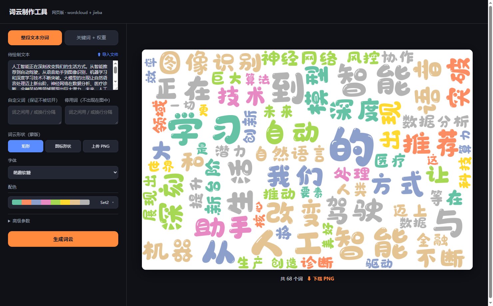
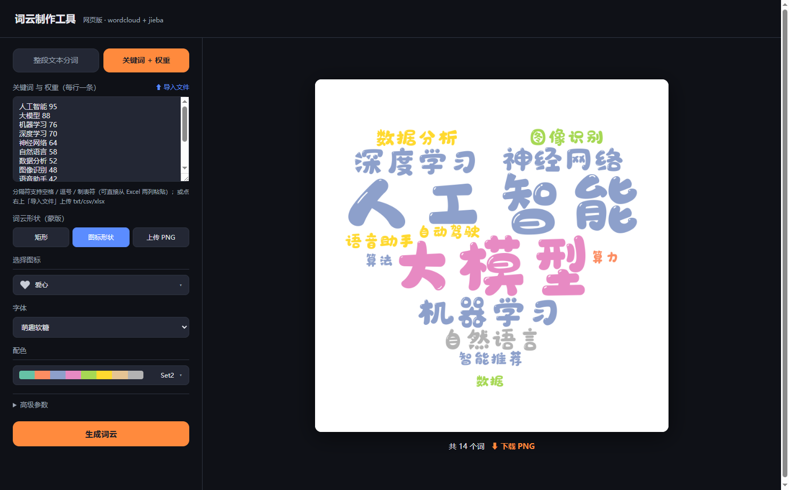

# 词云制作工具 · 网页版

基于 **Flask + wordcloud + jieba** 的中文词云在线生成工具。打开网页即可使用,支持整段文本分词、关键词权重、图标/图片蒙版,词云在服务端渲染成 PNG 返回。

<!-- caige-author:start -->
**作者：才哥** · 微信公众号：**可以叫我才哥**

微信扫码关注：


<!-- caige-author:end -->

## 界面预览

**整段文本分词 · 矩形词云**



**关键词 + 权重 · 爱心图标蒙版**



## 功能特性

- **两种输入模式**
  - 整段文本分词:粘贴中文文本,jieba 自动分词后生成词云,支持自定义词、停用词。
  - 关键词 + 权重:逐行填写「关键词 权重」,分隔符支持空格 / 逗号 / 制表符。
- **文件导入**:支持上传 `.txt` / `.csv` / `.xlsx`,自动识别编码(utf-8 / gbk),省去大段文本手动粘贴。
- **三种蒙版形状**
  - 矩形(默认,自定义宽高)
  - 内置 Font Awesome 图标(云朵、爱心、五角星等 12 种,带预览)
  - 上传 PNG/JPG 自定义形状(白底 + 深色形状)
- **多字体**:内置萌趣软糖、新青年体,并自动检测系统中文字体(微软雅黑、黑体、宋体、仿宋、楷体等)。
- **配色预览**:10 套 colormap(Set2、tab10、viridis 等),下拉可视化色板选择。
- **高级参数**:背景色、最大词数、宽高、字号范围可调。
- 生成结果支持一键下载 PNG。

## 环境要求

- Python 3.8+(开发环境为 Python 3.12)
- Windows / macOS / Linux 均可。注意:字体在**服务端**渲染进 PNG,客户端无需安装字体;但若部署到 macOS / Linux,系统自带的 `C:\Windows\Fonts` 字体不存在,需自行调整 `app.py` 中的 `FONTS` 路径。

## 安装

```bash
pip install -r requirements.txt
```

> 说明:`stylecloud` 仅用于复用其自带的 Font Awesome 字体资源(图标蒙版);`setuptools<81` 是因为新版 setuptools 移除了 `pkg_resources`,会导致 stylecloud 导入失败。

## 运行

```bash
python app.py
```

启动后浏览器打开 <http://127.0.0.1:5000> 即可使用。

## 项目结构

```
词云/
├─ app.py                          # Flask 后端(路由、分词、蒙版、词云生成)
├─ templates/
│  └─ index.html                   # 单页前端(交互、预览、上传)
├─ requirements.txt                # 依赖清单
├─ WenYue-XinQingNianTi-W8-J-2.otf # 内置字体:新青年体
├─ 字魂萌趣软糖体.ttf              # 内置字体:萌趣软糖
├─ 词云.py                         # 旧版脚本:剪贴板词频 → 词云(matplotlib)
└─ 词云绘制工具.py                 # 旧版脚本:PySimpleGUI 桌面工具(已被网页版替代)
```

## 接口说明

| 方法 | 路径 | 说明 |
| --- | --- | --- |
| GET | `/` | 主页面 |
| POST | `/api/import` | 上传 txt/csv/xlsx,返回解析后的文本 |
| POST | `/api/generate` | 提交参数生成词云,返回 base64 PNG |

## 备注

- 旧版脚本 `词云.py`、`词云绘制工具.py` 为早期实现,功能已被网页版覆盖,保留作参考。
- 后台服务为前台进程,关闭终端即停止;长期使用建议用 `nohup` / 任务计划程序等方式托管。
